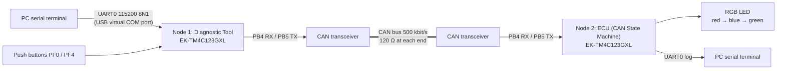

# CAN Bus Diagnostics

**Two TI Tiva C LaunchPads talking over CAN: a diagnostic tool sends UDS-style session, read and write requests to an ECU that runs an LED state machine. Written in layered, MISRA C:2004-checked embedded C.**

B.Sc. team course project for *Automotive Embedded Networking*, Ain Shams University, September 2019.

▶ **[Watch the demo video](https://www.youtube.com/watch?v=dRj1WanOhFA)**

## What it demonstrates

- **CAN communication between two microcontrollers.** Two TM4C123GH6PM (ARM Cortex-M4F) nodes on a 500 kbit/s bus, using interrupt-driven transmit and receive with error detection.
- **UDS-style diagnostic sessions and services.** A default and an extended session, a Read service allowed only in the default session, a Write service allowed only in the extended session, positive responses formed by adding `0x40` to the service ID, and negative responses when a service is not allowed in the active session.
- **A layered embedded C architecture.** Application layer, ECU abstraction layer, and TI's TivaWare driver library as the MCU abstraction layer. Every function has a documented API.
- **MISRA C:2004 compliance.** Checked with the TI compiler's MISRA checker. The few deviations are documented with justifications (see [MISRA notes](#misra-c2004-notes)).
- **Zero compiler warnings** with the TI ARM compiler, as recorded in the [project report](docs/Final_Project_Report.pdf).

## System overview



- **Node 1, Diagnostic Tool (`diagnostic-tool/`).** Takes commands from a UART console and the on-board buttons, sends CAN requests, and prints each response, or `Time Out` if none arrives within about 500 ms.
- **Node 2, ECU (`ecu-state-machine/`).** Steps an RGB LED state machine clockwise or counter-clockwise and answers diagnostic requests according to the active session.

Layer diagrams for both nodes are in [docs/architecture.md](docs/architecture.md).

## Protocol

The service ID travels as the 11-bit CAN identifier, and the first payload byte carries the parameter. The full byte-level tables are in [docs/protocol.md](docs/protocol.md).

| Service | Request ID | Allowed session | Positive response | Negative response |
|---|---|---|---|---|
| Session Control (default / extended) | `0x10` | any | `0x50` | none |
| Read (LED state / direction) | `0x22` | default only | `0x62` | `0x22` |
| Write (LED colour / direction) | `0x2E` | extended only | `0x6E` | `0x2E` |
| Step clockwise | `0x31` | any | none | none |
| Step counter-clockwise | `0x32` | any | none | none |

This protocol is **UDS-style**, not an ISO 14229 implementation. For example, negative responses reuse the request ID instead of the UDS `0x7F` format, and there is no ISO-TP transport layer.

## Hardware

| Qty | Part | Notes |
|---|---|---|
| 2 | TI EK-TM4C123GXL LaunchPad (TM4C123GH6PM) | One per node |
| 2 | 3.3 V CAN transceiver, **for example SN65HVD230** | Example part only. The original transceiver is not recorded in the report or code. Any 3.3 V-compatible transceiver works |
| 2 | 120 Ω resistor | One across CANH–CANL at each end of the bus. Many transceiver breakout boards already include one, so check before adding another |
| — | Twisted pair or jumper wires, 2 USB cables | |

**Wiring for each node:**

| LaunchPad | Transceiver |
|---|---|
| PB5 (CAN0TX) | TXD / D |
| PB4 (CAN0RX) | RXD / R |
| 3.3 V | VCC |
| GND | GND |

Connect **CANH to CANH** and **CANL to CANL** between the two transceivers, and join the two boards' grounds.

## Building

The project was built in **Code Composer Studio (CCS)** with the TI ARM compiler, against **TivaWare for C Series 2.1.4.178** (the version recorded in the original TI files).

> **Build check (2026).** Both nodes were rebuilt with `arm-none-eabi-gcc` 13.2 against TivaWare 2.1.4.178. Every source compiles and both firmware images link with no unresolved symbols, so the sources in this repository are complete. GCC's warnings are all GCC-specific rather than missing code: it does not recognise TI's `CHECK_MISRA` pragmas, it expects `int main`, and it reports one unused variable in `Switches.c`. The original CCS build was not re-run, because TI's compiler is not available in the check environment.

### TI files this repository does not include

TI's license terms restrict redistributing some TivaWare files, so the repository ships only our own sources. You get the rest from TivaWare ([ti.com/tool/SW-TM4C](https://www.ti.com/tool/SW-TM4C)) or from CCS itself:

| File | Where it comes from | What to do |
|---|---|---|
| `tm4c123gh6pm_startup_ccs.c` | Generated by CCS when you create a TM4C123GH6PM project | Keep it in the project and edit the vector table (step 5 below) |
| `tm4c123gh6pm.cmd` (linker script) | Generated by CCS with the startup file | Keep as is (see the note in step 5) |
| `tm4c123gh6pm.h` | `<TivaWare>/inc/` | Nothing to copy. Found through the include path |
| `uartstdio.c`, `uartstdio.h` | `<TivaWare>/utils/` | Link `uartstdio.c` into the project. The header is found through the include path |
| `interrupt.h` | `<TivaWare>/driverlib/` | Nothing to copy. Found through the include path |
| `driverlib.lib` | `<TivaWare>/driverlib/ccs/Debug/` | Add to the linker's file search path |

`<TivaWare>` is your install folder, for example `C:\ti\TivaWare_C_Series-2.1.4.178`.

### Steps (repeat for each node)

1. **Create the project.** Choose *File → New → CCS Project*. Set Target to *Tiva C Series → TM4C123GH6PM*, Connection to *Stellaris In-Circuit Debug Interface*, and Template to *Empty Project* (not "with main.c"). Name it after the node.
2. **Add the sources.** Copy every `.c` and `.h` file from `ecu-state-machine/` or `diagnostic-tool/` into the project.
3. **Compiler settings.** Open *Project → Properties → Build → ARM Compiler*.
   - Under *Include Options*, add `<TivaWare>` and `<TivaWare>/inc`.
   - Under *Predefined Symbols*, add `PART_TM4C123GH6PM`. `driverlib/pin_map.h` needs this to define the CAN and UART pin macros.
4. **Linker and UART utility.**
   - Under *ARM Linker → File Search Path*, add `<TivaWare>/driverlib/ccs/Debug/driverlib.lib`.
   - Choose *Project → Add Files…*, pick `<TivaWare>/utils/uartstdio.c`, and select *Link to files*.
5. **Edit the vector table** in `tm4c123gh6pm_startup_ccs.c`:
   - Next to the other `extern` declarations, add:
     ```c
     extern void CANIntHandler(void);
     extern void Switches_HANDLER(void);   /* Diagnostic Tool only */
     ```
   - Both nodes: replace `IntDefaultHandler` on the line commented `// CAN0` with `CANIntHandler`.
   - Diagnostic Tool only: replace `IntDefaultHandler` on the line commented `// GPIO Port F` with `Switches_HANDLER`.
   - Diagnostic Tool only: it also registers its button handler at run time (`IntRegister`), which moves the vector table into RAM. Check that `tm4c123gh6pm.cmd` places a `.vtable` section at the start of SRAM (`.vtable : > 0x20000000`). TivaWare's example linker scripts include this line; add it if yours does not.
6. **Optional: run the MISRA check.** Under *ARM Compiler → Advanced Options → MISRA-C:2004*, enable the checker. The sources already wrap the TivaWare includes in `#pragma CHECK_MISRA("none")` / `RESET_MISRA("all")`.
7. **Build and flash.** Build the project, then *Run → Debug* (F11) to program the board.

## How to use it

1. Connect each LaunchPad to the PC through its **DEBUG** USB port and open its virtual COM port in a serial terminal (PuTTY, Tera Term, or the CCS terminal) at **115200 baud, 8 data bits, no parity, 1 stop bit**.
2. Set the terminal to send **CR only** when you press Enter (PuTTY's default). The console reads the character after Enter as the next key, so a trailing LF would be read as an invalid choice.
3. Power both boards. The ECU starts in the **default session** with the **green** LED on.

**Console commands on the Diagnostic Tool.** Type the service, press Enter, then press the option key(s) **without** pressing Enter:

| Type | Then press | Request sent |
|---|---|---|
| `0x10` Enter | `0` / `1` | Switch to default / extended session |
| `0x22` Enter | `0` / `1` | Read LED state / direction (default session only) |
| `0x2E` Enter | `0` then `1` / `2` / `3` | Write LED red / blue / green (extended session only) |
| `0x2E` Enter | `1` then `1` / `2` | Write direction clockwise / counter-clockwise (extended session only) |

The Diagnostic Tool prints the response, for example `State is Green.`, `Red is assigned.`, `Service Not Supported in Active Session.`, or `Time Out`. The ECU logs each request on its own console.

**Buttons on the Diagnostic Tool:**

| Button | Request | Effect on the ECU |
|---|---|---|
| **PF0**, printed **SW2** on the LaunchPad | `0x31` | One step clockwise: red → blue → green → red |
| **PF4**, printed **SW1** on the LaunchPad | `0x32` | One step counter-clockwise: red → green → blue → red |

The firmware's own messages call PF0 "SW1" and PF4 "SW2", the reverse of the board's printed labels.

Each button press moves the LED by one step. The step commands are accepted in either session and get no response. Some quirks of the original code, such as the first step after reset, are listed in [docs/protocol.md](docs/protocol.md#notes-on-observed-behaviour). They were deliberately left unchanged.

## MISRA C:2004 notes

Both nodes were checked with the TI compiler's MISRA C:2004 checker. All *required* rules are applied on both nodes, and all *advisory* rules are also applied on the Diagnostic Tool, except for the deviations below. The full text is in the report (pages 12 and 22).

| Rule | Where | Justification given in the report |
|---|---|---|
| **10.6** "U" suffix on unsigned constants | ECU: `CAN0.c`, `InitConsole.c`, `LEDs.c`. Diagnostic Tool: `CAN0.c`, `Switches.c`, `UART_Init.c` | The violations come from TivaWare macros such as `SYSCTL_PERIPH_GPIOF`. Replacing them with literals like `0xf0000805U` would comply, but was rejected to avoid hard-coded values. Editing `driverlib/sysctl.h` did not clear the message |
| **19.4** Macro expansion forms | Both nodes | Enabling this rule made CCS fail every file with `gmake: *** [CAN0.obj] Error 1`. The issue was reported on TI's E2E forum and was unresolved at the time |
| **11.3** Casts between pointer and integer types | Diagnostic Tool: `Switches.c` (GPIO unlock and interrupt-status register access) | Required by the TivaWare register-access macros (`HWREG`, `GPIO_PORTF_MIS_R`) |

TivaWare headers are excluded from checking with `#pragma CHECK_MISRA("none")`, because third-party code is outside the project's scope. The line numbers cited in the report still match the files in this repository: the cleanup changed only whitespace and comments, never line positions.

## Repository layout

```
can-bus-diagnostics/
├── diagnostic-tool/        Node 1 sources (flat CCS project layout)
├── ecu-state-machine/      Node 2 sources
└── docs/
    ├── Final_Project_Report.pdf   Original 2019 report (static architecture, API, MISRA)
    ├── architecture.md            Layer diagrams for both nodes
    ├── protocol.md                Byte-level protocol and behaviour notes
    └── CHANGES.md                 Every change made since the 2019 submission
```

The first commit contains the code exactly as submitted in 2019, without the TI files. Later commits are cosmetic: line endings, indentation and comment typos. They also fix two include lines and reconstruct `PositiveResponse.h`, which was missing from the original archive. Every change is listed in [docs/CHANGES.md](docs/CHANGES.md).

## Demo

[](https://www.youtube.com/watch?v=dRj1WanOhFA)

Both LaunchPads running on a CAN bus (video on YouTube).

## Authors

- **Philopatear Salib**

Ain Shams University, *Automotive Embedded Networking*, September 2019.

The original source headers use the name Philopatear Ashraf.

## License

No license has been chosen yet, so all rights are reserved by the authors until a `LICENSE` file is added. TivaWare is © Texas Instruments and is not part of this repository.
