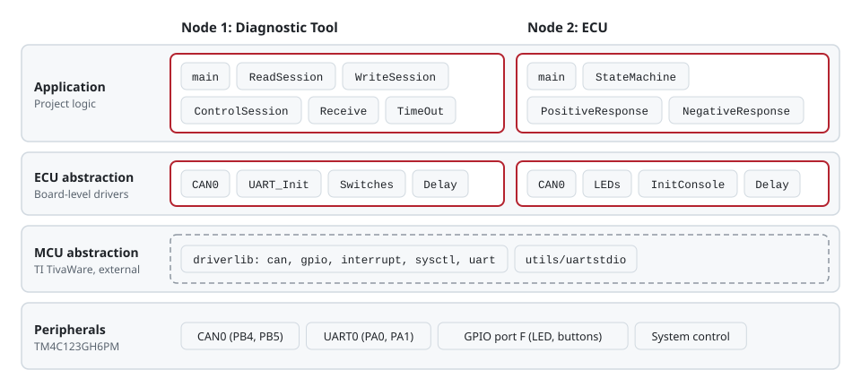
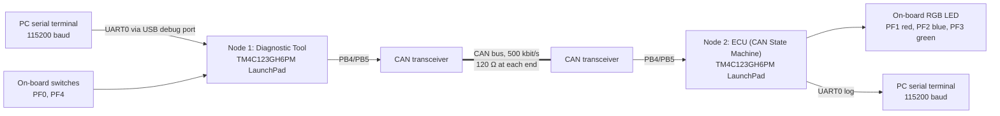
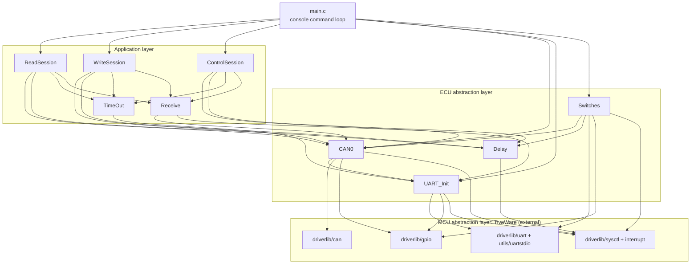
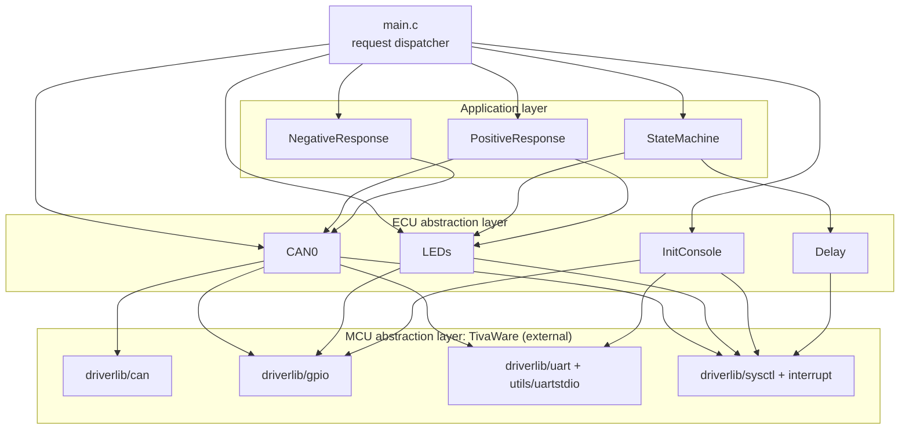

# Architecture

Both nodes use the same layered static architecture, described in the 2019 report (pages 4 and 15 of `Final_Project_Report.pdf`):

| Layer | Contents |
|---|---|
| **Application** | Project logic: the diagnostic services on the tool, the state machine and responses on the ECU |
| **ECU abstraction** | Project modules wrapping the board: `CAN0`, LEDs, switches, console, delays |
| **MCU abstraction** | TI TivaWare `driverlib` and `utils/uartstdio` (not part of this repository) |
| **Peripherals** | TM4C123GH6PM on-chip CAN0, GPIO, UART0 and system control |

The module-to-layer assignment follows the report's figures. The arrows below follow the `#include` and call relationships in the code. Direct `UARTprintf`/`UARTgetc` calls from the application modules are left out for readability.

## System overview

## Node 1: Diagnostic Tool (`diagnostic-tool/`)

| Module | Layer | Responsibility |
|---|---|---|
| `main.c` | Application (entry point) | Initialises CAN, UART and switches, then reads commands (`0x10`, `0x22`, `0x2E`) from the console |
| `ReadSession` | Application | Sends Read requests (LED state / direction) and waits for the reply |
| `WriteSession` | Application | Sends Write requests (LED colour / direction) and waits for the reply |
| `ControlSession` | Application | Sends Session Control requests (default / extended) |
| `Receive` | Application | Decodes a response ID and payload and prints it |
| `TimeOut` | Application | Prints `Time Out` and clears the receive flag |
| `CAN0` | ECU abstraction | CAN0 init, interrupt handler, send/receive helpers |
| `UART_Init` | ECU abstraction | Clock and UART0 console setup, message printing |
| `Switches` | ECU abstraction | PF0/PF4 interrupt setup and handler, sends `0x31` / `0x32` |
| `Delay` | ECU abstraction | Busy-wait delays (1 s, 500 ms timeout, 500 ms debounce) |

## Node 2: ECU / CAN State Machine (`ecu-state-machine/`)

| Module | Layer | Responsibility |
|---|---|---|
| `main.c` | Application (entry point) | Initialises the node and dispatches each received frame by CAN ID and current session |
| `StateMachine` | Application | Advances the LED one step clockwise or counter-clockwise |
| `PositiveResponse` | Application | Executes allowed Read / Write / Session Control requests and sends the `+0x40` response |
| `NegativeResponse` | Application | Sends the negative response for a service not allowed in the active session |
| `CAN0` | ECU abstraction | CAN0 init, interrupt handler, send helpers, receive helpers |
| `LEDs` | ECU abstraction | RGB LED init, on/off, and read-back |
| `InitConsole` | ECU abstraction | Clock and UART0 console setup |
| `Delay` | ECU abstraction | 1 s busy-wait delay |

## Notes

- The report's figures label the bottom-right driver as "Systick". The functions in that box are `SysCtlDelay`, `SysCtlPeripheralEnable` and `SysCtlPeripheralReady`, from TivaWare's `sysctl` driver. The project does not use the SysTick timer.
- Both nodes run from the 16 MHz main oscillator without the PLL (`SYSCTL_SYSDIV_1 | SYSCTL_USE_OSC | SYSCTL_OSC_MAIN | SYSCTL_XTAL_16MHZ`). UART0 is clocked from the 16 MHz PIOSC.
- Interrupt handlers (`CANIntHandler` on both nodes, `Switches_HANDLER` on the Diagnostic Tool) are placed in the vector table of TI's CCS startup file. That file is not included here, so the README explains the required edits.
