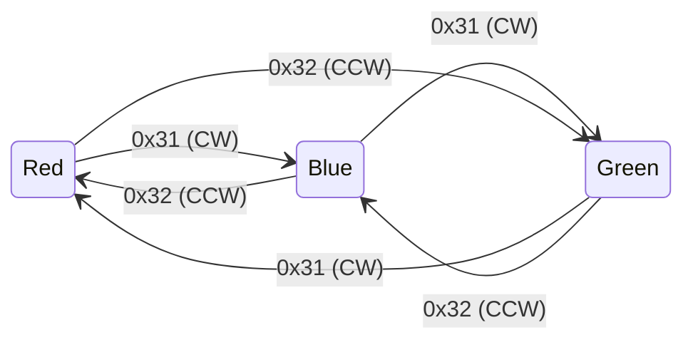
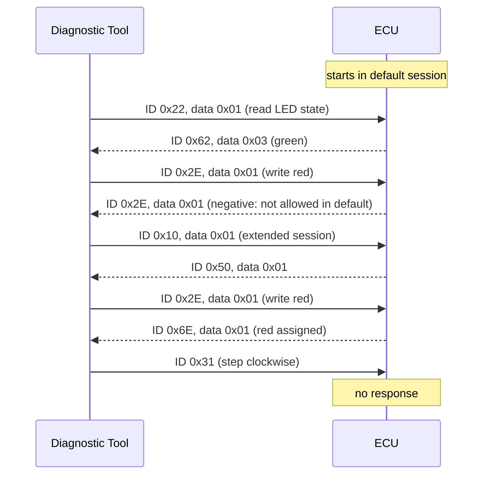

# Diagnostic protocol

The two nodes talk over CAN using a small **UDS-style** request/response scheme: diagnostic sessions, a read service, a write service, and positive responses formed by adding `0x40` to the service ID. It borrows UDS conventions but is **not** an ISO 14229 implementation (see [Differences from UDS](#differences-from-uds)).

Everything below was taken from the source code. Where the 2019 report presents something differently, that is called out.

## Bus and frame format

| Parameter | Value | Source |
|---|---|---|
| Bit rate | 500 kbit/s | `CANBitRateSet(..., 500000)` in both `CAN0.c` files |
| Identifier | 11-bit standard (transmit objects do not set `MSG_OBJ_EXTENDED_ID`) | `Send_Command`, `Send_State`, `Send_Dir`, `Send_Session` |
| CAN identifier | Carries the service ID itself (e.g. a Read request is sent on ID `0x22`) | |
| Payload | `data[0]` carries the parameter (sub-function / data identifier / value) | |
| Request length | 4 bytes, of which only `data[0]` is meaningful (see note 1) | Diagnostic Tool `CAN0.c` |
| Response length | 1 byte | ECU `CAN0.c` |
| Receive filter | Both nodes accept every identifier (ID mask `0`) | `Establishing_Getting_MSGs`, `EstablishingGettingMessage` |
| Message objects | Diagnostic Tool: TX object 2, RX object 1. ECU: RX object 2, TX object 1 | |

## Requests (Diagnostic Tool → ECU)

| Service | CAN ID | Payload `data[0]` | Console input on the Diagnostic Tool | Allowed session |
|---|---|---|---|---|
| Session Control: default | `0x10` | `0x00` | `0x10` then `0` | any |
| Session Control: extended | `0x10` | `0x01` | `0x10` then `1` | any |
| Read LED state | `0x22` | `0x01` | `0x22` then `0` | default only |
| Read direction | `0x22` | `0x02` | `0x22` then `1` | default only |
| Write LED red | `0x2E` | `0x01` | `0x2E` then `0` `1` | extended only |
| Write LED blue | `0x2E` | `0x02` | `0x2E` then `0` `2` | extended only |
| Write LED green | `0x2E` | `0x03` | `0x2E` then `0` `3` | extended only |
| Write direction CW | `0x2E` | `0x04` | `0x2E` then `1` `1` | extended only |
| Write direction CCW | `0x2E` | `0x05` | `0x2E` then `1` `2` | extended only |
| Step clockwise | `0x31` | `0x01` (ignored by the ECU) | switch on PF0 | any |
| Step counter-clockwise | `0x32` | `0x02` (ignored by the ECU) | switch on PF4 | any |

The console input column shows the keys typed on the Diagnostic Tool's UART console. The **Data Format** table in the 2019 report lists these console keys, not the bytes on the bus. For example, "Read State" is key `0` on the console but payload `0x01` on CAN.

## Responses (ECU → Diagnostic Tool)

| Request | Session | Response CAN ID | Payload | Diagnostic Tool prints |
|---|---|---|---|---|
| `0x10` / `0x00` | any | `0x50` (positive) | `0x00` | `Read Session is only allowed.` |
| `0x10` / `0x01` | any | `0x50` (positive) | `0x01` | `Write Session is only allowed.` |
| `0x22` / `0x01` | default | `0x62` (positive) | `0x01` red, `0x02` blue, `0x03` green | `State is Red.` / `Blue.` / `Green.` |
| `0x22` / `0x02` | default | `0x62` (positive) | `0x04` CW, `0x05` CCW | `Direction is Clockwise.` / `Counter Clockwise.` |
| `0x22` / any | extended | `0x22` (negative) | `0x00` | `Service Not Supported in Active Session.` |
| `0x2E` / `0x01`–`0x05` | extended | `0x6E` (positive) | echoes the written value | `Red is assigned.` … `Counter Clockwise is assigned.` |
| `0x2E` / any | default | `0x2E` (negative) | `0x01` | `Service Not Supported in Active Session.` |
| `0x31`, `0x32` | any | no response | | |

If no response arrives within about 500 ms, the Diagnostic Tool prints `Time Out`.

## Session rules

The ECU starts in the **default** session after reset.

| Service | Default session | Extended session |
|---|---|---|
| `0x10` Session Control | positive `0x50` | positive `0x50` |
| `0x22` Read | positive `0x62` | negative (`0x22`) |
| `0x2E` Write | negative (`0x2E`) | positive `0x6E` |
| `0x31` / `0x32` Step | executed, no response | executed, no response |

## State machine behaviour

Each `0x31` or `0x32` frame advances the RGB LED (PF1 red, PF2 blue, PF3 green) by **one step**. The LEDs do not rotate on their own.

The stored direction, which `0x22`/`0x02` reports, is set by the last step command or by writing `0x04`/`0x05`.

## Example exchanges

## Differences from UDS

- The service ID travels as the CAN identifier rather than as the first payload byte, and there is no ISO-TP transport layer.
- Negative responses reuse the request's identifier (`0x22` or `0x2E`) with a one-byte payload. They do not use the UDS format `0x7F <SID> <NRC>`.
- `0x31` and `0x32` are project-specific commands. In UDS, `0x31` is RoutineControl. Here they simply step the LED state machine.
- There is no security access, tester-present, or session timeout.

## Notes on observed behaviour

These describe what the code does. None of them has been changed.

1. **Request length.** The Diagnostic Tool's `Send_Command` sets the frame length to `sizeof(data)`, where `data` is a pointer. On the Cortex-M4 that is 4 bytes, so each request carries the command byte followed by 3 bytes of adjacent memory. The ECU reads only `data[0]`.
2. **No reply cases.** The ECU stays silent, and the tool reports `Time Out`, for a Read/Write/Session payload outside the values above. The tool's console only offers valid values, so this occurs only with another CAN sender on the bus.
3. **The `0x10` negative response** is decoded by the Diagnostic Tool, but the ECU never sends it.
4. **Timeout.** The timeout is a fixed `SysCtlDelay` of about 500 ms after sending, followed by a check of the receive flag. It is not a hardware timer.
5. **Initial state.** The ECU lights green at start-up, while its internal state-machine position starts at red. As a result, the first `0x31` shows blue, and the first `0x32` shows green (no visible change).
6. **Writing a colour** (`0x2E` with `0x01`–`0x03`) changes the LED but not the state-machine position. The next step continues from the previous position.
7. **Unused variable (Diagnostic Tool, `Switches.c`).** Line 54 declares `sw2`, which is never used. Any interrupt that is not from PF0 is treated as the PF4 button.
